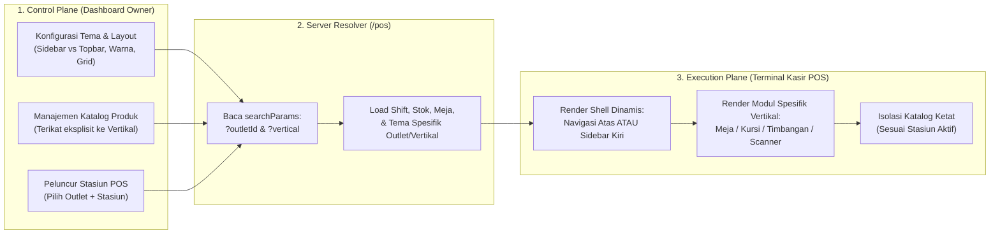

# Analisa Arsitektur, Evaluasi Miss-Konsep & Blueprint Pengembangan POS SaaS Multi-Vertikal

Dokumen ini menyajikan hasil audit menyeluruh terhadap kode sumber dan arsitektur aplikasi **Qassa Cloud POS (`pos-universal`)**, mencakup evaluasi alur kerja dari Dashboard ke POS, bedah fitur yang *miss-konsep* atau belum optimal, perancangan **Dynamic UI & Theme Engine (Top Navigation vs Left Sidebar)**, serta rekomendasi fitur standar industri POS SaaS modern.

---

## 1. Evaluasi Alur Kerja: Dari Dashboard ke Mesin Kasir (POS)

### 1.1. Bagaimana Alur Saat Ini Berjalan?
1. **Di Dashboard ([`src/app/dashboard/layout.tsx`](file:///c:/wamp64/www/projectKasir/src/app/dashboard/layout.tsx)):**
   - Pengguna (Owner) melihat tombol CTA **"Buka Kasir POS"** ([`src/components/pos/open-pos-button.tsx`](file:///c:/wamp64/www/projectKasir/src/components/pos/open-pos-button.tsx)).
   - Jika tenant memiliki `> 1` vertikal aktif atau `> 1` cabang (outlet), tombol tersebut membuka modal **Terminal Kasir Multi-Vertikal** untuk memilih:
     1. Cabang Operasional (`outletId`)
     2. Mode Stasiun Kerja (`CAFE`, `BARBERSHOP`, `LAUNDRY`, `RETAIL`)
   - Lalu sistem mengarahkan ke URL `/pos?vertical=CAFE&outletId=...`.

### 1.2. Bagaimana Seharusnya Alur Ini Berjalan (Ideal Flow)?
Ada beberapa celah kritis pada alur di atas yang membuat pengalaman pengguna belum mulus:



---

## 2. Daftar Temuan "Miss Konsep" & Masalah Arsitektur Saat Ini

Berdasarkan hasil bedah kode di seluruh repositori, berikut adalah **7 Miss Konsep Utama** yang ditemukan:

### ❌ Miss Konsep 1: Blueprint Tema & Navigasi Sudah Ada di Schema, Tapi Tidak Dieksekusi di UI (Dead Blueprint)
> [!WARNING]
> Di [`src/types/plugin-package.ts`](file:///c:/wamp64/www/projectKasir/src/types/plugin-package.ts#L104-L111), Anda sebenarnya **sudah merancang skema yang sangat bagus**:
> - `showCategoriesAs: "horizontal_pills" | "sidebar_left" | "vertical_sidebar" | "dropdown" | "tabs"`
> - `cartDock: "right" | "left" | "bottom" | "floating"`
> - `productCardStyle: "grid_card" | "compact_row" | "large_photo" | "pill_list"`
> - `productGridColumns: 2..8`
> - `colors.sidebar` & `colors.sidebarForeground`
>
> **Masalahnya:**
> 1. **Di Dashboard ([`layout.tsx`](file:///c:/wamp64/www/projectKasir/src/app/dashboard/layout.tsx) & [`dashboard-nav-links.tsx`](file:///c:/wamp64/www/projectKasir/src/app/dashboard/dashboard-nav-links.tsx)):** Navigasi 100% di-*hardcode* sebagai **Horizontal Pill Bar di atas**. Belum ada implementasi layout ketika tema mengatur navigasi menjadi **Sidebar Kiri (Left Sidebar)**.
> 2. **Di POS ([`pos-client.tsx:2269`](file:///c:/wamp64/www/projectKasir/src/app/pos/pos-client.tsx#L2269)):** Kategori dan stasiun kerja 100% di-*hardcode* sebagai **Horizontal Pills di atas**. Properti `showCategoriesAs === "sidebar_left"`, `productCardStyle`, dan `productGridColumns` dari tema **diabaikan sama sekali** oleh JSX.

---

### ❌ Miss Konsep 2: "Mode Bisnis Vertikal" Menimpa "Tema Tata Letak (POS Layout)"
Di [`src/app/pos/pos-client.tsx:502-509`](file:///c:/wamp64/www/projectKasir/src/app/pos/pos-client.tsx#L502-L509):
```tsx
const posLayout: PosLayoutType =
  activeVerticalPos === "CAFE" ? "CAFE_RESTO"
  : activeVerticalPos === "BARBERSHOP" ? "BARBERSHOP_STATION"
  : activeVerticalPos === "LAUNDRY" ? "LAUNDRY_WEIGHING"
  : "RETAIL_FAST_BARCODE";
```
- **Kesalahan Konsep:** Sistem mencampuradukkan antara **Logika Operasional Vertikal** dengan **Tata Letak Visual (UI Layout)**.
- **Dampaknya:** Meskipun pengguna membeli atau mengaktifkan layout di menu Store (misalnya ingin keranjang di kiri, kategori di sidebar vertikal, atau tampilan daftar kompak), pilihan tersebut tidak berefek penuh karena `posLayout` dipaksa mengikuti nama vertikal.
- **Seharusnya:**
  - **Vertical Engine** menentukan *fitur fungsional* apa yang aktif (apakah ada pemilih meja, pemilih kapster, input Kg laundry, atau auto-barcode).
  - **Theme & Layout Engine** menentukan *bagaimana UI dirender* (apakah navigasi di atas atau di sidebar kiri, apakah produk berupa kartu foto besar atau baris tabel cepat, apakah keranjang di kanan atau di kiri).

---

### ❌ Miss Konsep 3: `PosPage` Server Component Mengabaikan Parameter `outletId` dari URL
Di [`src/app/pos/page.tsx:16-17`](file:///c:/wamp64/www/projectKasir/src/app/pos/page.tsx#L16-L17):
```tsx
const shiftData = await getCurrentShiftData();
const targetOutletId = user.outletId || shiftData?.currentOutletId || shiftData?.outlets?.[0]?.id;
```
- **Kesalahan Konsep:** Ketika Owner memilih **Cabang 2** melalui tombol *Buka Kasir POS* di Dashboard (`/pos?vertical=CAFE&outletId=id-cabang-2`), fungsi `PosPage()` di server **tidak membaca `searchParams.outletId`**.
- **Dampaknya:** Server selalu mengambil data Shift, Stok Produk, dan Denah Meja dari Cabang pertama (`outlets[0]`), sementara client mengira sedang berada di Cabang 2. Ini berbahaya bagi akurasi stok dan laporan kas antar cabang.

---

### ❌ Miss Konsep 4: Penyimpanan Konfigurasi Sistem di Dalam `receiptConfig` (God-Object Anti-Pattern)
Di [`src/modules/store/actions.ts`](file:///c:/wamp64/www/projectKasir/src/modules/store/actions.ts) dan [`src/modules/tenant/settings-actions.ts`](file:///c:/wamp64/www/projectKasir/src/modules/tenant/settings-actions.ts):
- Konfigurasi tema POS (`posThemeCode`, `posLayout`), daftar tema yang dibeli (`purchasedLayoutIds`), hingga konfigurasi vertikal disimpan menumpang di dalam JSON `Tenant.receiptConfig` (yang seharusnya khusus untuk konfigurasi cetak struk kertas thermal).
- Sementara di skema Prisma (`prisma/schema.prisma`), sebenarnya sudah tersedia kolom `Tenant.attributes` (JSON) dan tabel `TenantTheme` (`customConfig` JSON).

---

### ❌ Miss Konsep 5: Fragmentasi Menu "Store & Tema" vs "Galeri Tema" vs "Pengaturan Tema"
Saat ini pengguna dihadapkan pada **3 halaman berbeda** untuk mengatur tampilan:
1. `/dashboard/store` (Memiliki tab: *POS Layouts*, *Receipt Themes*, *UI Themes*)
2. `/dashboard/themes` (Halaman *Galeri Tema & Layout Dinamis*)
3. `/dashboard/settings` -> Tab *Themes* & Tab *Receipt*
- **Dampaknya:** Pengguna bingung harus mengatur tema di mana, dan perubahan di satu halaman kadang tidak sinkron dengan state `DynamicThemeProvider` di halaman lain.

---

### ❌ Miss Konsep 6: Penentuan Vertikal Produk Mengandalkan "Tebakan" (Heuristik) jika Tidak Diisi
Di [`src/app/pos/pos-client.tsx:1716-1732`](file:///c:/wamp64/www/projectKasir/src/app/pos/pos-client.tsx#L1716-L1732):
- Fungsi `getProductVertical(p)` mencoba menebak vertikal produk dari nama kategori atau satuan (`Cup`, `Porsi`, `JASA`).
- Jika seorang pemilik Barbershop membuat produk minuman dingin bersatuan `Cup` tanpa label `verticalType`, atau membuat jasa cuci sepatu, produk tersebut bisa "nyasar" ke vertikal lain.
- **Seharusnya:** Setiap produk memiliki atribut `verticalType` yang wajib dan tervalidasi saat produk dibuat di `/dashboard/products`, disesuaikan dengan tab vertikal di halaman produk.

---

### ❌ Miss Konsep 7: Monolith File di `pos-client.tsx` (5.401 Baris Kode)
- Seluruh state dan tampilan untuk Cafe, Barbershop, Laundry, Retail, QRIS, Split Bill, Live Order, Kas Masuk/Keluar, dan Struk menumpuk di satu file [`src/app/pos/pos-client.tsx`](file:///c:/wamp64/www/projectKasir/src/app/pos/pos-client.tsx) sepanjang **5.401 baris**.
- Hal ini menyulitkan pembuatan sistem layout yang *customizable* dan *modular*.

---

## 3. Rancangan UI Dinamis & Customizable Theme Engine (Top Nav vs Left Sidebar)

Sesuai keinginan Anda agar **navigasi tab bisa berada di atas (Topbar) atau di kiri (Sidebar) dan dapat dikonfigurasi melalui Tema**, berikut adalah arsitektur **Configurable Layout Shell** yang direkomendasikan:

### 3.1. Dua Mode Navigasi Utama di Dashboard & POS

| Dimensi Konfigurasi | Opsi 1: `TOP_NAV` (Horizontal Bar Atas) | Opsi 2: `SIDEBAR_LEFT` (Collapsible Sidebar Kiri) |
|---|---|---|
| **Tampilan di Dashboard** | Menu (*Ringkasan, Outlet, Produk, Staf, Modul Usaha, Laporan*) berjajar horizontal di bawah header. Cocok untuk layar kecil/tablet. | Menu berada di panel vertikal sebelah kiri (bisa *expanded* 250px atau *collapsed* ikon 68px). Memberikan ruang vertikal lebih luas untuk tabel & grafik. |
| **Tampilan Kategori & Stasiun di POS** | Kategori produk & switcher stasiun berada di baris horizontal di atas katalog produk. | Sidebar vertikal di sisi paling kiri layar POS berisi: **Switcher Stasiun**, **Daftar Kategori Produk Vertikal** dengan ikon/jumlah item, dan **Quick Actions**. |
| **Gaya Kartu Produk POS (`productCardStyle`)** | `GRID_CARD` (Kartu persegi dengan foto) atau `LARGE_PHOTO` (Kartu visual besar ala Kafe). | `COMPACT_ROW` (Baris daftar padat untuk Retail ribuan SKU) atau `PILL_TILE` (Tombol cepat tanpa foto untuk jasa Barbershop/Laundry). |
| **Posisi Keranjang POS (`cartDock`)** | `RIGHT` (Standar kasir layar sentuh kanan) | `LEFT` (Dekat dengan sidebar navigasi) atau `BOTTOM_DRAWER` (Layar sempit/mobile). |

### 3.2. Struktur JSON Konfigurasi Tema (`TenantTheme.customConfig`)
Kita dapat memperluas token tema yang sudah ada menjadi standar yang benar-benar dikonsumsi oleh `DashboardLayout` dan `PosClient`:

```json
{
  "themePreset": "MODERN_INDIGO",
  "mode": "light",
  "colors": {
    "primary": "#4f46e5",
    "accent": "#06b6d4",
    "background": "#f8fafc",
    "card": "#ffffff",
    "sidebar": "#0f172a",
    "sidebarForeground": "#f8fafc",
    "border": "#e2e8f0"
  },
  "shell": {
    "dashboardNavPosition": "SIDEBAR_LEFT",
    "sidebarCollapsedByDefault": false,
    "posCategoryPosition": "SIDEBAR_LEFT",
    "posStationSwitcherStyle": "SIDEBAR_RAIL",
    "posCartDock": "RIGHT",
    "posGridColumns": 4,
    "posCardStyle": "GRID_CARD",
    "density": "COMFORTABLE",
    "borderRadius": "1rem"
  }
}
```

### 3.3. Visualisasi Layout POS dengan `SIDEBAR_LEFT` vs `TOP_NAV`

```
+-----------------------------------------------------------------------------------+
| [Logo] Barberku • Outlet Utama (Shift Aktif)        [Tertunda] [Riwayat] [Kas] [X]|
+------------+--------------------------------------------------+-------------------+
| STASIUN    | [ 🔍 Cari produk atau scan barcode SKU...      ] | KERANJANG (3)     |
| [☕ Kafe ] |--------------------------------------------------| 👤 Pelanggan CRM  |
| [💈 Barber]| [💈 Kursi 1] [Kursi 2] | 👤 Stylist: Rian      ▾ | 🪑 Meja 02 (Dine) |
| [🧺 Laund] |--------------------------------------------------|-------------------|
| [🛒 Retail]|  +-------------+  +-------------+  +-----------+ | 1x Kopi Aren  18k |
|------------|  | [Foto Menu] |  | [Foto Menu] |  | [Foto]    | | 1x Croissant  24k |
| KATEGORI   |  | Kopi Aren   |  | Matcha Ice  |  | Croissant | |                   |
| • Semua(30)|  | Rp 18.000   |  | Rp 22.000   |  | Rp 24.000 | |                   |
| • Makanan  |  +-------------+  +-------------+  +-----------+ |-------------------|
| • Minuman  |  +-------------+  +-------------+  +-----------+ | Subtotal    42.000|
| • Camilan  |  | [Foto Menu] |  | [Foto Menu] |  | [Foto]    | | PB1 (10%)    4.200|
|            |  | Nasi Goreng |  | Mie Seafood |  | French Fr | | TOTAL     Rp46.200|
|            |  | Rp 28.000   |  | Rp 27.000   |  | Rp 16.000 | | [ BAYAR SEKARANG ]|
+------------+--------------------------------------------------+-------------------+
  ^ Panel Kiri Dinamis (Bisa dipindah ke Atas atau Kiri lewat Pengaturan Tema!)
```

---

## 4. Fitur Apa Saja yang Seharusnya Ada dalam POS SaaS Standar Industri?

Berikut adalah matriks evaluasi fitur yang **Sudah Ada**, **Perlu Diperluas/Dioptimalkan**, dan **Fitur Baru yang Perlu Ditambahkan**:

### 4.1. Fitur yang Sudah Ada Tapi Perlu Dioptimalkan
| No | Fitur Saat Ini | Masalah / Kekurangan | Rekomendasi Optimasi |
|---|---|---|---|
| 1 | **Multi-Vertical POS Switcher** | Berpindah stasiun tidak mengunci keranjang; item stasiun sebelumnya masih tertinggal di keranjang jika belum checkout. | Saat kasir ganti stasiun (misal dari Cafe ke Barber) dan keranjang tidak kosong, tampilkan opsi: *"Simpan ke Pesanan Tertunda (Hold) untuk Stasiun Kafe"* atau *"Gabung Transaksi (Cross-Sell)"*. |
| 2 | **Manajemen Meja Kafe (`CafeTable`)** | Denah meja hanya berupa grid tombol di dalam modal, belum terlihat langsung sebagai *Floor Plan View* di layar utama POS Kafe. | Tambahkan tab cepat di layar POS Kafe: **[📋 Menu Produk]** dan **[🪑 Denah Meja Live]**, sehingga kasir/waiter bisa melihat meja kosong/terisi, durasi duduk tamu, dan klik meja untuk langsung *Open Bill* atau *Split Bill*. |
| 3 | **Antrean & Kursi Barbershop** | Kursi (`Kursi 1..4`) masih di-*hardcode* sebagai array statis `["Kursi 1", "Kursi 2", "Kursi 3", "Kursi 4"]` di `pos-client.tsx:2106`. | Jumlah kursi harus dinamis dari konfigurasi outlet/barbershop, lengkap dengan indikator status kursi (*Kosong*, *Sedang Dicukur oleh Kapster X*, *Estimasi Selesai*). |
| 4 | **Timbangan & Order Laundry** | Transaksi di POS Laundry hanya masuk ke tabel `Transaction`, belum otomatis membuat record di tabel `LaundryOrder` (tracking status *Diterima -> Cuci -> Kering -> Setrika -> Siap Ambil*). | Saat checkout di Stasiun Laundry, otomatis buat entri `LaundryOrder` dengan nomor nota `LND-...`, estimasi tanggal selesai, parfum, dan rak, sehingga langsung muncul di menu `/dashboard/laundry/orders`. |
| 5 | **Manajemen Produk (`/dashboard/products`)** | Saat tambah/edit produk, pemilihan vertikal dan tampilan filter per vertikal belum tegas. | Tambahkan Tab Filter Vertikal di halaman Produk Dashboard (`Semua`, `☕ Kafe`, `💈 Barber`, `🧺 Laundry`, `🛒 Retail`) dan wajibkan field `Unit Vertikal` saat membuat produk. |

---

### 4.2. Fitur Penting POS SaaS yang Perlu Ditambahkan / Diperluas

1. **Live Theme & Layout Customizer Drawer (Visual Builder)**
   - Alih-alih sekadar memilih preset statis, berikan **Panel Customizer Live** (di halaman Tema/Store) di mana Owner bisa mengatur secara interaktif:
     - **Posisi Navigasi Dashboard:** `Top Bar Horizontal` vs `Left Sidebar (Collapsible)`
     - **Posisi Kategori POS:** `Top Horizontal Pills` vs `Left Vertical Sidebar`
     - **Posisi Keranjang POS:** `Kanan (Right)` vs `Kiri (Left)`
     - **Gaya Tampilan Produk:** `Kartu Foto Besar (3 Kolom)`, `Kartu Standar (4 Kolom)`, `Grid Padat (5 Kolom)`, atau `Baris Tabel Kasir Cepat (List View)`
     - **Palet Warna & Dark/Light Mode:** Pilihan warna utama, aksen, dan sudut lengkung (*Sharp*, *Rounded*, *Pill*).

2. **Split Bill & Gabung Meja (Merge/Transfer Table) untuk Kafe & Resto**
   - Saat ini sudah ada *Split Payment* (bayar sebagian tunai, sebagian QRIS). Namun di restoran sangat dibutuhkan **Split Bill by Item** (Misal: Meja 04 berisi 4 orang, masing-masing ingin membayar makanan yang mereka pesan sendiri-sendiri) serta **Pindah/Gabung Meja**.

3. **Produk Modifier, Add-on & Paket Bundling Dinamis**
   - Saat ini modifier minuman di [`pos-client.tsx:524-528`](file:///c:/wamp64/www/projectKasir/src/app/pos/pos-client.tsx#L524-L528) masih di-*hardcode* (`Normal Sweet`, `Normal Ice`, `Fresh Milk`, `Extra Shot`).
   - Seharusnya modifier disimpan di `Product.attributes.modifiers` (misal: *Topping Boba +Rp 5.000*, *Level Pedas 1-5*, *Upgrade Pomade Premium +Rp 10.000*) sehingga fleksibel untuk semua jenis bisnis.

4. **Customer Loyalty Points & Member Tiering (CRM Lanjutan)**
   - Tabel `Customer` sudah mencatat `visits` dan `totalSpent`. Ini sangat mudah diperluas dengan **Poin Loyalitas Otomatis** (misal: setiap belanja Rp 10.000 dapat 1 poin, atau gratis 1x cukur setelah 5x kunjungan sesuai teks banner struk Anda!).

5. **Mode Layar Pelanggan (Customer Facing Display / Dual Screen)**
   - Halaman ringan `/pos/display` yang tersinkronisasi via `BroadcastChannel` browser lokal. Jika kasir menggunakan PC/Tablet dua layar, layar kedua menghadap pelanggan untuk menampilkan rincian item yang sedang di-scan, diskon, dan **QRIS Dinamis besar** saat pembayaran.

6. **Keyboard Shortcuts Penuh & Mode Offline-Resilient**
   - Indikator shortcut keyboard yang jelas di UI (`F2` Cari Produk, `F4` Pilih Pelanggan, `F8` Tunda Transaksi, `F9` Bayar Cepat, `ESC` Batal) untuk mempercepat kasir saat jam sibuk.

---

## 5. Rencana Aksi & Prioritas Rekomendasi (Action Plan)

Jika Anda setuju untuk mengoptimalkan sistem ini, berikut urutan langkah pengerjaan yang paling berdampak tinggi dan rapi:

1. **Tahap 1 — Unifikasi Theme & Layout Engine (Prioritas Utama Anda):**
   - Mengaktifkan fitur **Dynamic Navigation Shell**: Pilihan **Top Navigation Bar** vs **Left Collapsible Sidebar** baik di Dashboard maupun di POS.
   - Menghubungkan pengaturan Tema (`posCategoryPosition`, `cartDock`, `productGridColumns`, `productCardStyle`, `dashboardNavPosition`) agar benar-benar mengubah tampilan Dashboard dan POS secara *real-time*.
   - Menyatukan pengaturan Tema & Layout agar tidak terpecah-pecah di 3 menu berbeda.

2. **Tahap 2 — Perbaikan Sinkronisasi Multi-Outlet & Multi-Vertikal:**
   - Memperbaiki [`src/app/pos/page.tsx`](file:///c:/wamp64/www/projectKasir/src/app/pos/page.tsx) agar membaca `searchParams` (`?outletId=...&vertical=...`) langsung dari server.
   - Menambahkan selector & filter tab **Unit Bisnis Vertikal** di halaman Manajemen Produk (`/dashboard/products`) agar Owner mudah mengelola menu tiap vertikal tanpa tercampur.

3. **Tahap 3 — Sinkronisasi Operasional Vertikal ke Database:**
   - Menghubungkan checkout POS Laundry agar otomatis membuat order di tabel `LaundryOrder`.
   - Membuat jumlah kursi Barbershop dan modifier menu Kafe menjadi dinamis (tidak *hardcoded*).
   - Memecah komponen raksasa `pos-client.tsx` menjadi sub-komponen modular yang bersih dan cepat.

