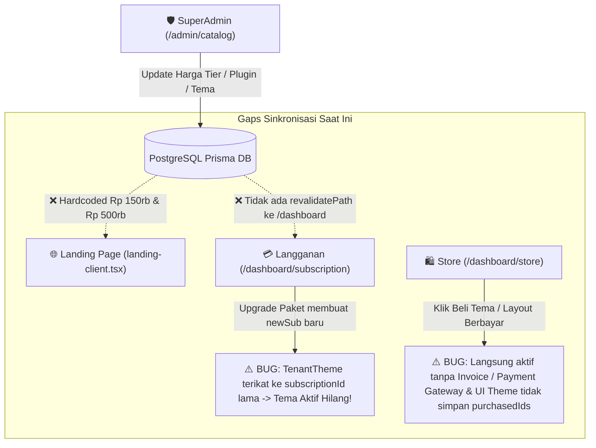
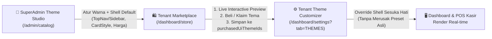

# 🔍 Audit Arsitektur Menyeluruh & Blueprint Rekomendasi Sistem Qassa Cloud POS (7 Pilar Utama)

Dokumen ini merangkum hasil audit menyeluruh terhadap kode sumber **POS Kasir (`/pos`)**, **Tenant Dashboard (`/dashboard`)**, **Marketplace/Store (`/dashboard/store`)**, **Langganan (`/dashboard/subscription`)**, **SuperAdmin (`/admin`)**, dan **Landing Page (`/`)**.

---

## 🗺️ Diagram Peta Masalah & Alur Sinkronisasi Saat Ini



---

## 1. 🔄 Sinkronisasi Antar-Modul (POS ↔ Dashboard ↔ Store ↔ Subscription ↔ SuperAdmin)

Hasil pengecekan menemukan **5 celah sinkronisasi kritis** yang menyebabkan perubahan di satu modul tidak tercermin atau bahkan merusak state di modul lain:

> [!WARNING]
> **1. Upgrade Langganan Menghapus Tema Aktif & Konfigurasi Shell (`TenantTheme` Orphan Bug)**
> Di [`src/modules/subscription/actions.ts`](file:///c:/wamp64/www/projectKasir/src/modules/subscription/actions.ts#L163-L183), saat tenant melakukan upgrade paket atau tambah plugin via `upgradeSubscriptionAction`, sistem menonaktifkan `TenantSubscription` lama (`isActive: false`) dan membuat record `TenantSubscription` baru (`newSub`).
> Karena tabel `TenantTheme` berelasi ke `subscriptionId` (bukan langsung ke `tenantId`), **tema UI aktif dan `customConfig` milik tenant tertinggal di `subscriptionId` lama**, sehingga setelah upgrade langganan, tema tenant tiba-tiba kembali ke default!

1. **Landing Page Mengabaikan Harga Live dari SuperAdmin**:
   - Server Component [`src/app/page.tsx`](file:///c:/wamp64/www/projectKasir/src/app/page.tsx#L19-L25) sudah mengambil `licenseTiers`, `plugins`, dan `themes` dari database.
   - Namun di [`src/app/landing-client.tsx`](file:///c:/wamp64/www/projectKasir/src/app/landing-client.tsx#L1068-L1069), kalkulator harga masih **hardcode** angka `150000` (Starter) dan `500000` (Pro), serta bagian `#store` tidak menampilkan katalog tema/plugin asli dari database. Saat SuperAdmin mengubah harga di `/admin/catalog`, harga di Landing Page tidak berubah.
2. **Perubahan Katalog di SuperAdmin Tidak Me-revalidate Halaman Tenant & Publik**:
   - Di [`src/modules/superadmin/actions.ts`](file:///c:/wamp64/www/projectKasir/src/modules/superadmin/actions.ts#L278-L362), fungsi `updateLicenseTierAction`, `updatePluginAction`, dan `updateThemeAction` hanya memanggil `revalidatePath("/admin/catalog")`. Seharusnya juga memanggil `revalidatePath("/")`, `revalidatePath("/dashboard/subscription")`, `revalidatePath("/dashboard/store")`, dan `revalidatePath("/pos")`.
3. **Pembelian Self-Service Tidak Tercatat di Keuangan SuperAdmin (`SubscriptionInvoice`)**:
   - Ketika tenant meng-upgrade paket di `/dashboard/subscription` ([`upgradeSubscriptionAction`](file:///c:/wamp64/www/projectKasir/src/modules/subscription/actions.ts#L126)) atau membeli tema/layout di `/dashboard/store` ([`purchasePosLayoutAction`](file:///c:/wamp64/www/projectKasir/src/modules/store/actions.ts#L316)), sistem **tidak membuat record `SubscriptionInvoice`**. Akibatnya, laporan pendapatan MRR/ARR di `/admin/finance` tidak sinkron dengan transaksi upgrade mandiri tenant.
4. **Kepemilikan UI Theme Berbayar Tidak Disimpan Permanen**:
   - Di [`src/modules/store/actions.ts`](file:///c:/wamp64/www/projectKasir/src/modules/store/actions.ts#L172-L216), tema struk menyimpan daftar `purchasedThemeIds` dan layout POS menyimpan `purchasedLayoutIds` di dalam `receiptConfig`. Namun untuk **Tema UI Sistem (`applyUiThemeAction`)**, tidak ada penyimpanan `purchasedUiThemeIds`. Jika tenant membeli Tema UI berbayar (Rp 49.000) lalu mencoba ganti ke tema lain, di [`src/modules/tenant/settings-actions.ts`](file:///c:/wamp64/www/projectKasir/src/modules/tenant/settings-actions.ts#L122) tema berbayar tersebut hilang dari daftar milik tenant karena filter hanya mengecek `priceMonthly === 0 || t.id === activeUiThemeId`.

---

## 2. 🐛 Bugs & Bottlenecks (Performa & Stabilitas Next.js 16)

> [!CAUTION]
> **1. Risiko Crash Next.js 16 `Decimal` RSC di Halaman SuperAdmin (`/admin/catalog` & `/admin/subscriptions`)**
> Di [`src/app/admin/catalog/page.tsx`](file:///c:/wamp64/www/projectKasir/src/app/admin/catalog/page.tsx#L9-L38), Server Component memanggil [`getCatalogPricingData()`](file:///c:/wamp64/www/projectKasir/src/modules/superadmin/actions.ts#L228-L246) yang mengembalikan objek Prisma mentah berisi `Decimal` (`priceMonthly`, `priceAnnual`) langsung ke Client Component `<CatalogClient />`. Di Next.js 16.4.3 (Turbopack), ini memicu error fatal:
> `Only plain objects can be passed to Client Components from Server Components. Decimal objects are not supported.`

2. **Bottleneck "Write-on-Read" di Dashboard SuperAdmin**:
   - Setiap kali halaman `/admin` dibuka, [`getSuperAdminDashboardData()`](file:///c:/wamp64/www/projectKasir/src/modules/superadmin/actions.ts#L22-L36) selalu menjalankan `ensureDefaultCatalogSeeded()` (belasan query `upsert` sekuensial untuk tier, plugin, dan tema) ditambah `prisma.tenant.updateMany` untuk mengunci trial yang kedaluwarsa. Ini membuat loading `/admin` lambat dan membebani koneksi database pada setiap request baca.
3. **Polling Berlebihan di Client POS**:
   - Di [`src/app/pos/pos-client.tsx`](file:///c:/wamp64/www/projectKasir/src/app/pos/pos-client.tsx), terdapat beberapa `setInterval` aktif (polling live orders setiap 15 detik, cek status pembayaran QRIS setiap 3.5 detik, timer durasi kursi barbershop setiap detik). Jika ada 50 tab kasir aktif secara bersamaan, server menerima ratusan request per menit.
   - **Rekomendasi**: Pause polling otomatis ketika tab browser sedang tidak aktif (`document.visibilityState === "hidden"`) dan gunakan debouncing/SSE.
4. **Load Seluruh Produk Tanpa Virtualisasi / Indexing Vertikal**:
   - [`getProductsData`](file:///c:/wamp64/www/projectKasir/src/modules/pos/actions.ts) memuat seluruh produk beserta kategori, varian, modifier, dan stok sekaligus ke memori client. Untuk minimarket/retail dengan 3.000+ SKU, render DOM secara serentak akan membuat perangkat tablet kasir lag.
5. **Komponen Monolitik Raksasa**:
   - [`src/app/pos/pos-client.tsx`](file:///c:/wamp64/www/projectKasir/src/app/pos/pos-client.tsx) (5.900+ baris) dan [`src/app/dashboard/settings/settings-client.tsx`](file:///c:/wamp64/www/projectKasir/src/app/dashboard/settings/settings-client.tsx) (2.900+ baris) membuat proses kompilasi HMR dan re-render state React menjadi berat.

---

## 3. ⚠️ Miss Konsep & Kesalahan Alur (Conceptual & Workflow Flaws)

### A. Pencampuran Konsep "Modul Vertikal Bisnis" vs "Add-on Utility Plugin"
Di tabel `Plugin` dan [`src/plugins/index.ts`](file:///c:/wamp64/www/projectKasir/src/plugins/index.ts#L21-L133), sistem menggabungkan dua hal yang secara konsep bisnis sangat berbeda:
- **Vertikal Bisnis Utama**: `barbershop`, `cafe`, `laundry`, `retail` (menentukan jenis stasiun kasir POS & menu operasional).
- **Plugin Utility / Add-on**: `self_order` (QR Meja), `whatsapp` (Notifikasi WA), `receipt_pro` (Custom Struk).

**Kesalahan Alur yang Terjadi**:
Di [`src/app/dashboard/subscription/subscription-client.tsx`](file:///c:/wamp64/www/projectKasir/src/app/dashboard/subscription/subscription-client.tsx#L126-L138) dan [`src/modules/subscription/actions.ts`](file:///c:/wamp64/www/projectKasir/src/modules/subscription/actions.ts#L155-L158), aturan *"Paket Basic hanya boleh memilih 1 bisnis vertikal"* ditulis dengan logika:
```ts
if (isBasicSelected && selectedPluginIds.length > 1) {
  selectedPluginIds = [selectedPluginIds[0]];
}
```
Akibatnya: **Jika tenant Paket Basic (1 vertikal Cafe) membeli add-on `self_order` (QR Meja) atau `whatsapp`, sistem menganggap tenant memilih 2 vertikal dan otomatis menghapus salah satunya!**
- **Solusi**: Pisahkan filter antara `VERTICAL_CODES = ["barbershop", "cafe", "laundry", "retail"]` (dibatasi 1 pada tier Basic) dan `ADDON_CODES = ["self_order", "whatsapp", "receipt_pro"]` (bebas dibeli sebagai add-on tambahan di semua tier).

### B. Celah Guard Autentikasi di Layout SuperAdmin
Di [`src/app/admin/layout.tsx`](file:///c:/wamp64/www/projectKasir/src/app/admin/layout.tsx#L25-L31):
```ts
if (!session || (session.user as any)?.role !== "SUPER_ADMIN") {
  // blok kosong!
}
```
Blok pengecekan tersebut kosong karena halaman `/admin/login` berada di dalam folder `/admin`. Akibatnya, jika user biasa mengakses `/admin/login`, sidebar SuperAdmin tetap ter-render di samping halaman login!
- **Solusi**: Cek path atau tampilkan layout polos tanpa sidebar jika `session.user.role !== "SUPER_ADMIN"`, dan wajibkan redirect ke `/admin/login` di semua sub-halaman `/admin/*`.

### C. Penegakan Kuota Lisensi (`outletLimit` & `kasirLimitPerOutlet`) Belum Ketat di Server Action
Di `/dashboard/subscription`, UI menampilkan bar penggunaan kuota Cabang (`outletsUsed / outletLimit`) dan Kasir (`cashiersUsed / kasirLimit`). Namun saat tenant membuat cabang baru atau menambah staf kasir baru di pengaturan, validasi server-side terhadap batas `LicenseTier` perlu diperketat agar tidak bisa ditembus lewat pemanggilan action langsung.

---

## 4. 🎨 Konsep Dinamis Theme dari Marketplace

Saat ini kita sudah membangun **Dynamic Shell & POS Layout Engine** (`ThemeShellConfig` dengan dukungan `TOP_NAV` vs `SIDEBAR_LEFT`, posisi kategori POS, posisi keranjang Kiri/Kanan, dan 3 gaya kartu produk). Agar konsep **Dynamic Theme Marketplace** berjalan utuh dari SuperAdmin hingga ke Kasir:



### Rekomendasi Penyempurnaan Marketplace Tema:
1. **Setiap Tema di Marketplace Memiliki "Blueprint Shell" Sendiri**:
   - Contoh: Tema **"Qassa Dark Luxe"** secara default mengaktifkan `SIDEBAR_LEFT` + mode gelap + kartu `LARGE_PHOTO`, sedangkan **"Modern Slate Compact"** mengaktifkan `TOP_NAV` + kartu `COMPACT_ROW` 5 kolom.
   - Saat tenant meng-klik **"Terapkan Tema"** di Marketplace, sistem otomatis menerapkan warna *sekaligus* tata letak bawaan tema tersebut, namun tenant tetap bisa meng-custom ulang posisi navigasinya (Atas/Kiri) lewat tombol **Tampilan UI**.
2. **Perbaikan Alur Pembelian Tema & Layout Berbayar**:
   - Simpan `purchasedUiThemeIds` di dalam konfigurasi tenant (sejajar dengan `purchasedThemeIds` dan `purchasedLayoutIds`).
   - Bedakan dengan jelas antara tombol **"Beli & Pasang (Rp 49.000)"** (mencatat invoice/pembelian terlebih dahulu) vs **"Pasang Sekarang"** (untuk tema gratis atau tema yang sudah dibeli).
3. **Upgrade Editor Tema di SuperAdmin (`/admin/catalog`)**:
   - Berikan kontrol bagi SuperAdmin untuk mengatur preset warna utama (`primaryColor`), mode (`LIGHT`/`DARK`), serta default `dashboardNavPosition` (`TOP_NAV`/`SIDEBAR_LEFT`) langsung dari halaman Katalog SuperAdmin.

---

## 5. 💳 Konsep Langganan (Subscription & Licensing Engine)

Agar model bisnis SaaS Qassa berjalan sehat, adil bagi tenant, dan akurat secara finansial:

1. **Pemisahan Jelas: Tier Lisensi vs Modul Vertikal vs Add-on Utility**:
   - **Tier Basic (Rp 150.000/bln)**: Maksimal **1 Modul Vertikal Bisnis** (pilih salah satu: Cafe *atau* Barbershop *atau* Retail *atau* Laundry), 1 Cabang Outlet, 5 Kasir. Tetap boleh membeli **Add-on Utility** (seperti QR Self-Order atau Notifikasi WA).
   - **Tier Pro (Rp 500.000/bln)**: **Multi-Vertikal Bisnis** (bisa menggabungkan Cafe + Barbershop + Laundry + Retail dalam 1 akun dengan stasiun POS terpisah), hingga 10 Cabang, Unlimited Kasir.
   - **Tier Enterprise**: Unlimited Cabang, Multi-Gudang, Custom API.
2. **Perhitungan Prorata & Akumulasi Masa Aktif (`periodEnd`)**:
   - Di [`src/modules/subscription/actions.ts`](file:///c:/wamp64/www/projectKasir/src/modules/subscription/actions.ts#L161), saat ini perpanjangan selalu dihitung dari `new Date()` (`addMonths(now, durationMonths)`), sehingga sisa hari aktif tenant hangus!
   - **Perbaikan**: Jika tenant memperpanjang paket pada tier yang sama sebelum `periodEnd` habis, tambahkan durasi baru dari `currentSubscription.periodEnd` (`addMonths(baseDate, durationMonths)`).
3. **Auto-Lock & Grace Period Otomatis Tanpa Menunggu SuperAdmin Login**:
   - Saat ini status `TRIAL` yang sudah lewat `trialEndAt` baru berubah menjadi `LOCKED` jika SuperAdmin membuka `/admin`.
   - **Perbaikan**: Di `DashboardLayout` dan `PosPage`, jika `now > effectiveEndDate` (masa trial/langganan habis), otomatis arahkan (redirect) user ke `/dashboard/subscription?expired=1` dengan banner peringatan perpanjangan, tanpa membiarkan akses ke `/pos` terbuka.
4. **Pencatatan Otomatis `SubscriptionInvoice`**:
   - Setiap kali terjadi perpanjangan/upgrade paket atau pembelian plugin/tema berbayar, buat record `SubscriptionInvoice` (`status: "PAID"`) secara transaksional di database agar metrik pendapatan di `/admin` dan `/admin/finance` langsung bertambah secara real-time.

---

## 6. ✨ UI/UX Lebih Menarik Termasuk Redesign Landing Page (`/`)

Landing page saat ini ([`src/app/landing-client.tsx`](file:///c:/wamp64/www/projectKasir/src/app/landing-client.tsx)) sudah memiliki simulasi struk thermal yang bagus, namun masih bisa ditingkatkan secara drastis agar terlihat seperti produk SaaS kelas dunia:

1. **Sinkronisasi Harga & Katalog 100% Real-Time dari Database**:
   - Gunakan prop `licenseTiers`, `plugins`, dan `themes` dari database di `LandingClient` (bukan angka hardcode Rp 150.000 / Rp 500.000), sehingga setiap perubahan harga atau diskon durasi oleh SuperAdmin langsung tampil detik itu juga di halaman depan.
2. **Interactive "Live Theme & Layout Playground" di Landing Page**:
   - Tambahkan seksi interaktif di mana pengunjung website bisa mencoba klik ganti posisi navigasi (**Top Navigation** vs **Left Sidebar**), ganti tema (**Dark Luxe**, **Warm Cafe**, **Modern Slate**), dan ganti **4 Stasiun POS Vertikal** secara langsung di dalam *mockup browser interaktif* di halaman utama!
3. **Visualisasi Ekosistem Multi-Vertikal & KDS / QR Self-Order**:
   - Tampilkan bagaimana 1 akun bisnis (misal: *Barber & Coffee Concept Store*) bisa memiliki 2 stasiun kasir berbeda namun laporan keuangannya terkonsolidasi otomatis di 1 Dashboard Owner.
4. **Peningkatan Kontras Visual & Micro-Interactions**:
   - Perbaiki palet warna Light/Dark mode di Landing Page, tambahkan *floating badge* metrik live, perbandingan fitur antar-tier yang lebih jelas, dan *showcase* kartu tema dari Qassa Store asli.

---

## 7. 🚀 Optimasi & Perluasan Fitur (Feature Expansion Roadmap)

Berikut fitur-fitur bernilai tinggi yang sudah memiliki fondasi di schema database Anda namun belum terhubung penuh di alur operasional:

| Area | Kondisi Saat Ini | Perluasan & Optimasi yang Direkomendasikan |
| :--- | :--- | :--- |
| **Loyalty & Poin CRM di POS** | Tabel `Customer` memiliki kolom `points`, `totalSpent`, dan `visits`, namun saat checkout POS poin belum bertambah/ditukar secara otomatis. | **Otomasi Earning & Redeem Poin di POS**: Setiap transaksi lunas otomatis menambah `totalSpent`, `visits (+1)`, dan `points` (misal 1 poin tiap Rp 10.000), serta kasir bisa menukar poin menjadi potongan harga di keranjang POS. |
| **Split Bill per Item (Cafe/Resto)** | POS sudah mendukung *Split Payment* (bayar sebagian Tunai + sebagian QRIS), namun belum mendukung *Split Bill per Item* untuk meja grup. | **Split Bill Meja**: Pelanggan di Meja 08 bisa memilih item mana saja yang ingin dibayar lebih dulu, sisanya tetap tinggal di tagihan meja aktif. |
| **Audio Beep & Hardware Feedback** | Scan barcode dan notifikasi order masuk hanya mengandalkan toast visual. | **Synthesized Web Audio Beep**: Suara *beep* instan (Web Audio API tanpa file MP3 eksternal) saat scan barcode berhasil, suara *error buzz* saat stok habis, dan *chime* saat pesanan QR Meja masuk. |
| **Quick Global Search (`Ctrl+K`) di Dashboard** | Navigasi menu memiliki banyak item. | **Command Palette (`Ctrl+K`)**: Tekan `Ctrl+K` di Dashboard untuk langsung melompat ke menu mana saja, mencari produk, atau membuka Stasiun POS tertentu dalam 1 detik. |

---

## 📋 Rencana Eksekusi Bertahap (Prioritized Action Plan)

Jika Anda setuju dengan hasil analisa di atas, kita dapat langsung mengeksekusinya secara bertahap dan terukur:

- **Tahap 1 — Perbaikan Bugs Kritis, Sinkronisasi Database & Keamanan SuperAdmin**:
  - Fix serialisasi `Decimal` di seluruh halaman SuperAdmin (`/admin/catalog`, `/admin`, `/admin/subscriptions`) agar bebas error Next.js 16 RSC.
  - Fix bug kehilangan tema saat upgrade langganan (`upgradeSubscriptionAction` otomatis memigrasikan `TenantTheme` ke `subscriptionId` baru).
  - Fix akumulasi masa aktif (`periodEnd`), pemisahan validasi **Bisnis Vertikal** vs **Add-on Plugin** pada Paket Basic, pencatatan otomatis `SubscriptionInvoice`, dan `revalidatePath` lintas modul.
  - Perbaiki guard autentikasi di [`src/app/admin/layout.tsx`](file:///c:/wamp64/www/projectKasir/src/app/admin/layout.tsx) dan optimasi query `getSuperAdminDashboardData`.
- **Tahap 2 — Penyempurnaan Dynamic Theme Marketplace & SuperAdmin Theme Studio**:
  - Simpan kepemilikan `purchasedUiThemeIds` secara permanen sehingga tema UI yang sudah dibeli tidak hilang saat berganti tema.
  - Hubungkan preset tema di Marketplace dengan konfigurasi `ThemeShellConfig` bawaan masing-masing tema + perluas editor tema di `/admin/catalog`.
- **Tahap 3 — Redesign Landing Page Interaktif & Sinkronisasi Harga Live**:
  - Hubungkan harga tier, plugin, dan tema di [`src/app/landing-client.tsx`](file:///c:/wamp64/www/projectKasir/src/app/landing-client.tsx) langsung ke data live database SuperAdmin.
  - Tambahkan **Interactive Theme & Multi-Layout POS Playground** di Landing Page.
- **Tahap 4 — Optimasi Performa POS & Perluasan Fitur (CRM Loyalty Points, Audio Beep, Smart Polling)**:
  - Aktifkan akumulasi & penukaran Poin Member otomatis saat checkout POS, Web Audio Beep untuk barcode scanner, dan optimasi smart polling saat tab tidak aktif.

